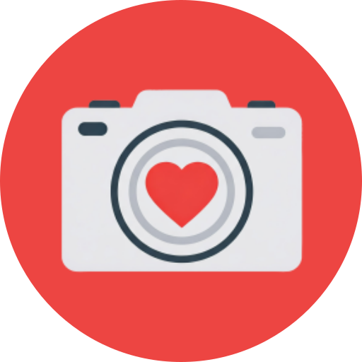
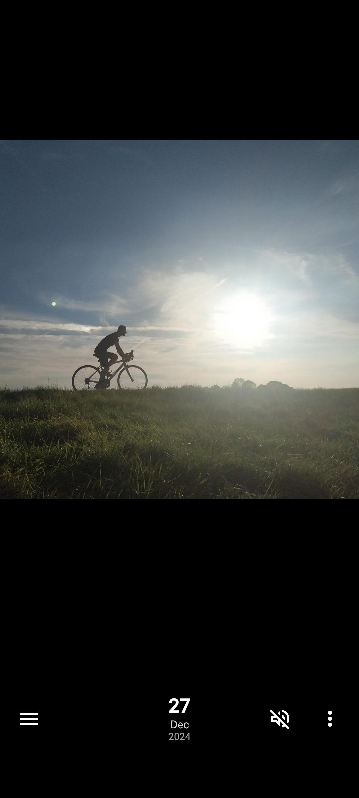
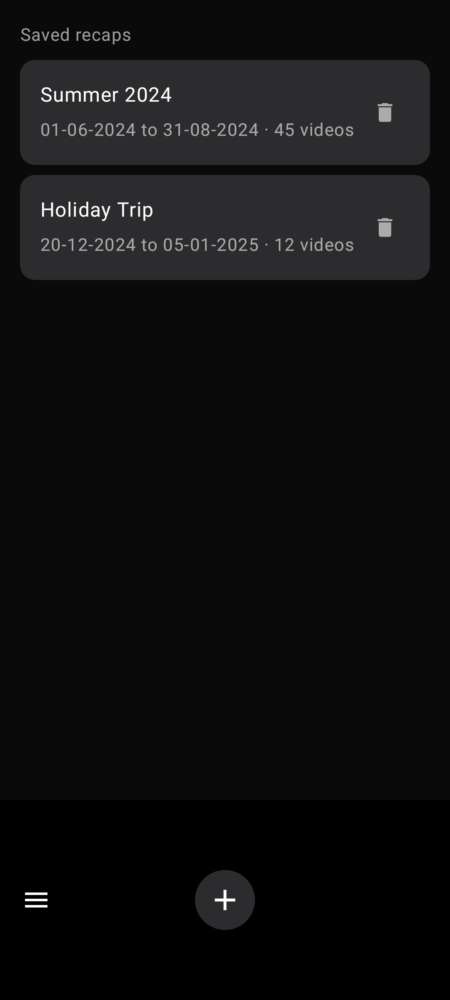
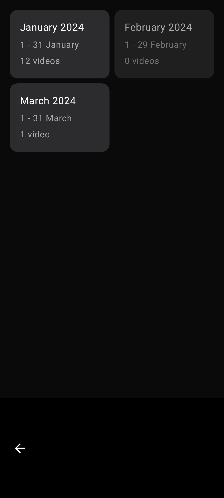

<!-- Generated from readme.yml by LukeNeedham/ci-workflows (docs/readme.md). Edit readme.yml, not this file. -->
<p align="center">
  
</p>

# Video Diary

Record your life in one short video a day.

[F-Droid](https://f-droid.org/packages/com.lukeneedham.videodiary) · [The story behind the project](https://www.lukeneedham.com/blog/video-diary)

## Description

Video Diary lets you record one short video a day, a snippet of your day, so don't miss your chance. Hop back in time
or scroll through the calendar to see what your past self was up to, and at any point export your diary to a single
video for a full recap of your life so far.

It is private: the app has no internet permission, so your videos stay on your own device. It works well in landscape,
and you choose the daily video duration, the video orientation and the camera resolution.

## Screenshots





## Getting started as a user

1. Install it from [F-Droid](https://f-droid.org/packages/com.lukeneedham.videodiary), or get the latest build from the [AppHub](https://www.lukeneedham.com/apphub) app or the [Releases](https://github.com/LukeNeedham/VideoDiary/releases) page.

Requires Android 6.0 (API 23) or newer.

## Getting started as a developer

Requirements: JDK 17 and the Android SDK (platform 36), for example through Android Studio.

```
git clone https://github.com/LukeNeedham/VideoDiary.git
cd VideoDiary
./gradlew assembleDebug    # the APK is in app/build/outputs/apk/debug/
./gradlew test             # unit tests
```

Every pull request is built by CI, which comments on it with a link to install the APK.

Like all my apps, it follows the shared architecture and conventions (single activity, Jetpack Compose, Navigation 3, MVVM with every page split into a `Page` and a `PageContent`, Koin): see [ci-workflows](https://github.com/LukeNeedham/ci-workflows/blob/main/docs/new-app.md).

The screenshot previews use the drawable `preview_video` as the placeholder image of a video player. It is a large
PNG, so it lives under `app/src/debug/res/drawable` and is left out of release builds; the default drawable folder
holds a simple fallback so that release builds still compile. See [docs/Screenshots.md](docs/Screenshots.md).

## Contributing

Branch from `main`, make the change, and open a pull request. CI must be green before it is merged.

## License

All rights reserved. See [LICENSE](LICENSE).
